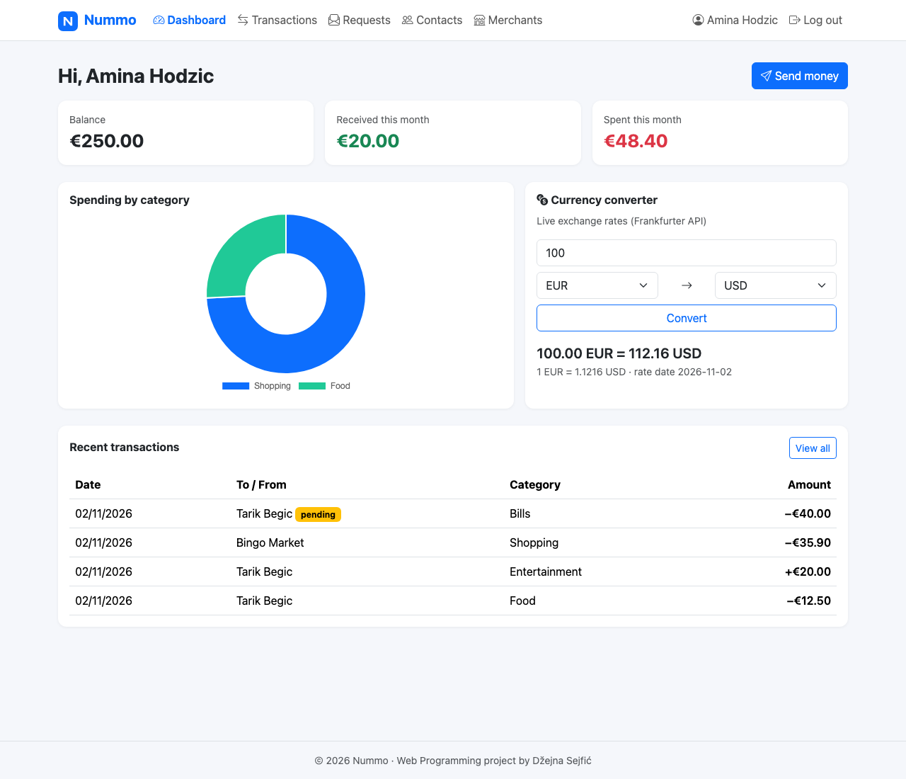
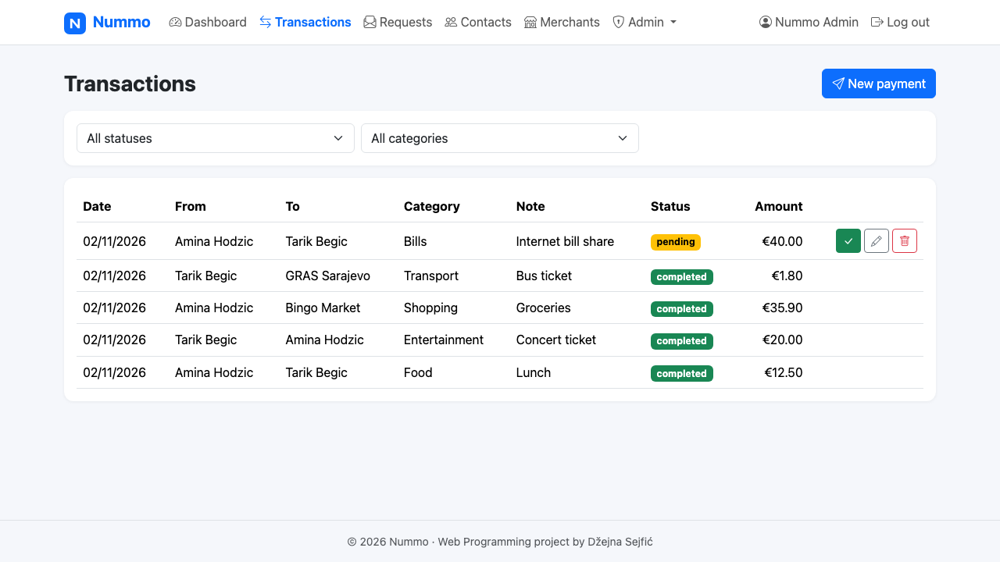
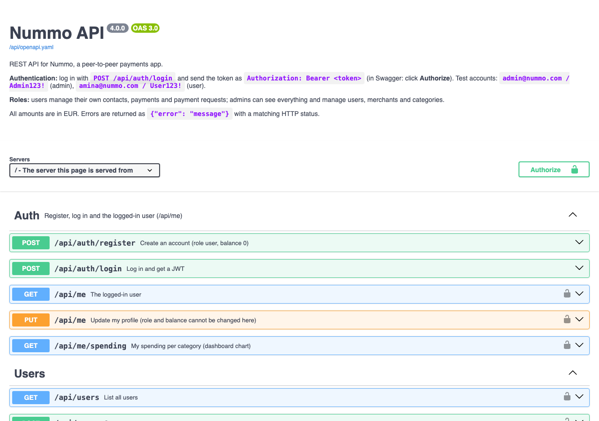
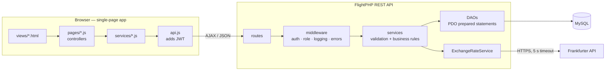

<div align="center">


# Nummo

**Send, request and track money between friends — a peer-to-peer payments web app.**


IBU · IT 2001 Web Programming · Džejna Sejfić

**Live app:** _coming soon_ · **API docs:** `/docs/` on the live app

</div>



## About

Nummo is a single-page web application for everyday payments between people. Users keep a balance,
add friends as contacts, send money to them or pay merchants, ask others for money with payment
requests, and see where their money goes on a spending chart. A built-in currency converter shows
live exchange rates. Administrators manage users, merchants and spending categories.

> **All balances in Nummo are simulated demo money.** No real funds are moved, stored or paid out.

### Features

- 💸 **Send money** to a contact or pay a merchant — balances update instantly and safely, even
  when two payments happen at the same moment
- 🔁 **Safe retries** — if the connection drops, pressing Send again never pays twice
- 🧾 **Receipts** — every payment has a reference and a receipt you can reopen from Transactions
- 📨 **Payment requests** — ask a friend for money; they can pay or decline with one click
- 👥 **Contacts** — add people by email, block or remove them
- 📊 **Dashboard** — balance, this month's income and spending, spending by category (Chart.js)
- 💱 **Currency converter** — live rates from the [Frankfurter API](https://frankfurter.dev)
- 🔐 **Accounts and roles** — register, log in with JWT; admin area for users, merchants, categories
- 📱 **Responsive** — works on phones, tablets and desktops

<table>
  <tr>
    <td width="50%"></td>
    <td width="50%"></td>
  </tr>
  <tr>
    <td align="center"><sub>Transactions with filters (admin view)</sub></td>
    <td align="center"><sub>Swagger API documentation</sub></td>
  </tr>
</table>

## Tech stack

| Layer | Technology |
|---|---|
| Frontend | HTML, CSS, JavaScript single-page app · Bootstrap 5 · Bootstrap Icons · Chart.js |
| Backend | PHP 8.1+ · FlightPHP 3 · PDO · firebase/php-jwt |
| Database | MySQL 8 |
| API docs | OpenAPI 3 + Swagger UI |
| External API | [Frankfurter](https://frankfurter.dev) — European Central Bank exchange rates |
| Deployment | Docker (Apache + PHP), environment-variable configuration |

## Architecture



Every request follows the same path: **click → AJAX call → route → middleware → service → DAO → SQL →
JSON response → UI update**, and each request is written to the info log.

## Database

Six entities with primary and foreign keys — full diagram in [docs/ERD.md](docs/ERD.md)
([dbdiagram.io source](docs/erd.dbml)).

| Entity | Purpose | Relationships |
|---|---|---|
| **users** | account, role (`user` / `admin`), balance (EUR), display currency | — |
| **categories** | spending categories (Food, Transport, …) | — |
| **merchants** | shops a user can pay | belongs to a category |
| **contacts** | a user's friend list (`pending`, `accepted`, `blocked`) | user → user |
| **transactions** | a payment to a user **or** a merchant | sender, receiver, merchant, category |
| **payment_requests** | one user asks another to pay; `transaction_id` links a paid request to its payment | requester → payer, → transaction |
| **idempotency_keys** | remembers which payment a retry key created, per user | user → transaction |

Users are **closed, never deleted**: `users.closed_at` marks a closed account, and foreign keys
(`ON DELETE RESTRICT`) protect the payment history.

## Roles and test accounts

These accounts exist only when the **demo data** is loaded (`sql/demo_seed.sql`, local use only).
Their balances are simulated.

| Role | Email | Password | Can do |
|---|---|---|---|
| admin | `admin@nummo.com` | `Admin123!` | See all data; manage users, merchants and categories |
| user | `amina@nummo.com` | `User123!` | Own profile, contacts, payments and payment requests |
| user | `tarik@nummo.com` | `User123!` | Same as above — use both to try payment requests |

Roles are enforced on the backend (`RoleMiddleware` → `403`, ownership checks in the services)
and reflected in the UI (the Admin menu and admin buttons are hidden from normal users).

## External API — currency converter

The dashboard converter and the balance shown in the user's own currency use the
[Frankfurter API](https://frankfurter.dev).

- `backend/services/ExchangeRateService.php` calls Frankfurter with a timeout (`rates_api_timeout`).
- Endpoints: `GET /api/rates`, `GET /api/rates/convert`, `GET /api/rates/currencies`.
- If Frankfurter is slow or down, the failure is written to the error log and the user sees a
  friendly message (`503`). The rest of the app keeps working.

## Getting started

**Requirements:** PHP 8.1+, Composer, MySQL 8.

```bash
# 1. Database: empty schema, then (optional, local only) the demo data with the test accounts
mysql -u root -p -e "CREATE DATABASE nummo_db CHARACTER SET utf8mb4 COLLATE utf8mb4_unicode_ci"
mysql -u root -p nummo_db < sql/schema.sql
mysql -u root -p nummo_db < sql/demo_seed.sql

# 2. Configuration: copy the template and fill in your database credentials and a JWT secret
cp backend/config/config.example.php backend/config/config.php

# 3. Backend dependencies
cd backend && composer install && cd ..

# 4. Start the API (http://localhost:8080) and the frontend (http://localhost:8000)
php -S localhost:8080 -t backend/public backend/public/index.php
cd frontend && php -S localhost:8000          # in a second terminal
```

Open **http://localhost:8000** and log in with a test account.
**Swagger:** http://localhost:8080/docs/ — click **Authorize** and paste a token from `POST /api/auth/login`.

### Tests

```bash
# Payment reliability against MySQL: races with independent connections, retries, rollback,
# receipts, closed accounts. Uses a throwaway database "nummo_test" on the server from config.php
# (dropped and recreated each run) — run it against a local MySQL, not production.
php backend/tests/payments_check.php

# Database layer: CRUD on every table, rolled back afterwards (needs the demo data)
php backend/tests/dao_check.php
```

### Upgrading an existing v1 database

The v2 migration keeps all data. Back up first, then run it once:

```bash
mysqldump -u root -p nummo_db > nummo_db_before_v2.sql
mysql -u root -p nummo_db < sql/migrations/001_v2_payment_reliability.sql
```

To roll back, deploy the v1 code and run `sql/migrations/001_v2_payment_reliability.rollback.sql`.
Transactions and requests are kept; idempotency keys, request → payment links and the closed flag
are lost (closed accounts become active again in v1).

## REST API

| Resource | Endpoints | Access |
|---|---|---|
| Auth | `POST /api/auth/register` · `POST /api/auth/login` | public |
| My profile | `GET` `PUT /api/me` · `GET /api/me/spending` | logged in |
| Users | `GET` `POST /api/users` · `GET` `PUT` `DELETE /api/users/{id}` · `GET /api/users/{id}/spending` | admin |
| Categories | `GET` `POST /api/categories` · `GET` `PUT` `DELETE /api/categories/{id}` | read: logged in · write: admin |
| Merchants | `GET` `POST /api/merchants` · `GET` `PUT` `DELETE /api/merchants/{id}` | read: logged in · write: admin |
| Contacts | `GET` `POST /api/contacts` · `GET` `PUT` `DELETE /api/contacts/{id}` | own data (admin: all) |
| Transactions | `GET` `POST /api/transactions` · `GET` `PUT` `DELETE /api/transactions/{id}` | own data (admin: all) |
| Payment requests | `GET` `POST /api/payment-requests` · `GET` `PUT` `DELETE /api/payment-requests/{id}` | own data (admin: all) |
| Exchange rates | `GET /api/rates` · `GET /api/rates/convert` · `GET /api/rates/currencies` | public |

All 39 operations are documented in [`backend/docs/openapi.yaml`](backend/docs/openapi.yaml).
Responses are JSON; errors look like `{"error": "message"}` with `400`, `401`, `403`, `404`, `409`,
`500` or `503`. Unexpected errors are logged but never expose SQL, file paths or stack traces.

<details>
<summary><b>Business rules</b></summary>

- A payment goes to **either** a user or a merchant. Completed payments move money between
  balances inside one database transaction, and the sender needs enough balance.
- Only pending payments can be changed; completed payments cannot be edited or deleted.
- Paying a payment request creates a completed payment from the payer to the requester.
- Users only see their own contacts, payments and requests. Only the payer can pay or decline a
  request; only the requester can change or delete it.
- Emails, category names and merchant names are unique; users cannot send money to themselves.
- **Concurrency:** each payment, settlement or delete runs in one database transaction. The row
  being changed is locked first (`SELECT … FOR UPDATE`), then the users' rows in id order, and the
  debit is one conditional statement (`… WHERE balance >= amount`), so two requests at the same
  moment can never overdraw an account or settle the same item twice. Amounts are exact decimals
  (`"12.50"`), never floats.
- **Retries:** `POST /api/transactions` accepts an optional `Idempotency-Key` header. The same key
  and body returns the first payment (`200`); the same key with a different body returns `409`.
  Paying an already paid request returns it unchanged, with its `transaction_id`.
- **Closing accounts:** `DELETE /api/users/{id}` closes the account. The user can no longer log in
  (existing tokens stop working), send, receive or be added as a contact; contacts are removed,
  pending payments become `failed` and pending requests `declined`. Completed payments, paid
  requests and the balance stay as records. Paid requests cannot be deleted.

</details>

<details>
<summary><b>Authentication, middleware and logging</b></summary>

Passwords are hashed with bcrypt. Logging in returns a JWT (HS256, valid 24 hours); the frontend
sends it as `Authorization: Bearer <token>` with every request. On `401` it logs out and opens the
login page; on `403` it shows the error.

| Middleware (`backend/middleware/`) | What it does |
|---|---|
| `AuthMiddleware` | Verifies the JWT on every protected route; `401` if missing, invalid or expired |
| `RoleMiddleware` | Reusable role check, e.g. `new RoleMiddleware('admin')`; `403` otherwise |
| `RequestLogger` | Writes every request to the info log |
| `ErrorHandler` | Catches all exceptions, logs them and returns a safe JSON error |

Logs (not committed to Git):

```text
backend/logs/info.log    every request, logins, registrations, external API calls
[2026-11-02 16:25:55] INFO GET /api/transactions?user_id=2 200 user=1 role=admin 2ms

backend/logs/error.log   exceptions, database errors, failed logins, 401/403, external API failures
[2026-11-02 16:25:55] ERROR GET /api/transactions/4 403 user=2 role=user You do not have access to this transaction
```

</details>

<details>
<summary><b>Frontend structure and validation</b></summary>

The frontend follows an MVC split: views hold only HTML, page controllers handle events and
rendering, and service files are the only code that talks to the backend.

```text
frontend/
├── index.html          app shell (navbar + <main id="app">)
├── views/              HTML templates, one per page
├── js/router.js        hash router with route guards (guest / user / admin)
├── js/pages/           one controller per page
├── js/services/        one service per API resource — the only code that calls the API
├── js/api.js           fetch wrapper: adds the JWT, handles 401/403
├── js/validation.js    client-side form validation
└── css/ · assets/
```

Every form is validated twice: in the browser (`js/validation.js`, rules from the HTML attributes
`required`, `type="email"`, `minlength`, `min`, `step`, …) and again on the server
(`backend/utils/Validator.php` and the services).

</details>

## Project structure

```text
nummo-webapp/
├── backend/
│   ├── config/        Settings, Database (PDO), config.example.php
│   ├── dao/           BaseDao + one DAO per table — all SQL lives here
│   ├── services/      business logic and validation, one service per entity
│   ├── routes/        FlightPHP routes, one file per resource
│   ├── middleware/    JWT auth, roles, request logging, error handling
│   ├── utils/         ApiException, Validator, Logger
│   ├── docs/          openapi.yaml
│   ├── public/        index.php (front controller), Swagger UI
│   ├── logs/          info.log, error.log (git-ignored)
│   ├── bin/           create_admin.php — create an admin or rotate a password
│   └── tests/         payments_check.php (races, retries), race_worker.php, dao_check.php
├── frontend/          single-page app
├── sql/               schema.sql, demo_seed.sql (opt-in), migrations/
├── docs/              ERD, screenshots, AI usage log
├── deploy/            Apache config and start script for Docker
├── Dockerfile
├── AGENTS.md          context and rules for AI coding assistants
└── README.md
```

## Deployment

The whole app runs as **one Docker container** (Apache + PHP): the frontend at `/`, the API at
`/api` and Swagger at `/docs/`. On the server there is no `config.php`; settings come from
environment variables.

| Variable | Value |
|---|---|
| `DB_HOST` `DB_PORT` `DB_NAME` `DB_USER` `DB_PASS` | MySQL connection (`DB_NAME=nummo_db`) |
| `JWT_SECRET` | a long random string, e.g. from `openssl rand -hex 32` |
| `RATES_API_URL` `RATES_API_TIMEOUT` | optional — defaults to Frankfurter and 5 seconds |
| `PORT` | set by the hosting platform (default 80) |

<details>
<summary><b>Deploying on Railway</b></summary>

1. On [railway.com](https://railway.com): **New Project → Deploy from GitHub repo** → `nummo-webapp`.
   Railway builds the `Dockerfile`.
2. **New → Database → MySQL**.
3. In the app service → **Variables**:
   ```text
   DB_HOST=${{MySQL.MYSQLHOST}}
   DB_PORT=${{MySQL.MYSQLPORT}}
   DB_USER=${{MySQL.MYSQLUSER}}
   DB_PASS=${{MySQL.MYSQLPASSWORD}}
   DB_NAME=nummo_db
   JWT_SECRET=<long random string>
   ```
4. Import the data using the MySQL service's public host and port (**Connect** tab):
   ```bash
   docker run --rm -i mysql:8.4 mysql -h <host> -P <port> -u root -p<password> -e "CREATE DATABASE nummo_db CHARACTER SET utf8mb4 COLLATE utf8mb4_unicode_ci"
   docker run --rm -i mysql:8.4 mysql -h <host> -P <port> -u root -p<password> nummo_db < sql/schema.sql
   ```
   Do **not** load `sql/demo_seed.sql` on a public deployment: its passwords are in this README.
5. App service → **Settings → Networking → Generate Domain**, then add the link at the top of this README.

Any other Docker host (DigitalOcean App Platform, Render, a VPS) works the same way.

</details>

### First admin and demo accounts

A deployment starts with no users. Create the first admin with your own email and a unique
password (asked for without echo, never passed on the command line):

```bash
php backend/bin/create_admin.php you@yourdomain.com "Your Name"            # local
railway ssh -- php /var/www/backend/bin/create_admin.php you@yourdomain.com  # Railway container
```

Running it again for an existing email makes that account an admin with the **new** password. Use
this to rotate the password of a seeded account. If demo data was ever loaded on a deployment:

- **Rotate** every seeded account you keep: `php backend/bin/create_admin.php admin@nummo.com`
  (for `amina@…` / `tarik@…`, an admin can also set a new password on the Users page).
- **Remove** the others: on the Users page click **Close account**. Closing keeps their payment
  history but blocks login immediately, including tokens that were already issued.

<details>
<summary><b>Running the production image locally</b></summary>

```bash
docker build -t nummo-app .
docker run -p 8090:80 -e DB_HOST=host.docker.internal -e DB_PORT=3306 -e DB_USER=root \
  -e DB_PASS=<password> -e DB_NAME=nummo_db -e JWT_SECRET=<secret> nummo-app
```

Open http://localhost:8090.

</details>

## Milestones

| | Milestone | Contents |
|---|---|---|
| ✅ | 1 · Setup, static frontend, ERD | project structure, single-page app, ERD |
| ✅ | 2 · Database and DAO layer | MySQL schema with sample data, DAO classes |
| ✅ | 3 · Services, routes, OpenAPI, external API | business logic, CRUD API, Swagger, currency rates |
| ✅ | 4 · Auth, middleware, logging, connected frontend | JWT, roles, logs, every page uses the API |
| ✅ | 5 · Frontend MVC, validations, deployment | client + server validation, Docker deployment |

## AI usage

AI tools were used during development and are documented as required by the course:
[`AGENTS.md`](AGENTS.md) describes the architecture and rules for AI assistants, and
[`docs/AI_LOG.md`](docs/AI_LOG.md) lists the tools, the main prompts and the cases where the AI was
wrong and how they were fixed, for each milestone.

---

<div align="center"><sub>Made by Džejna Sejfić for IT 2001 Web Programming at International Burch University.</sub></div>
