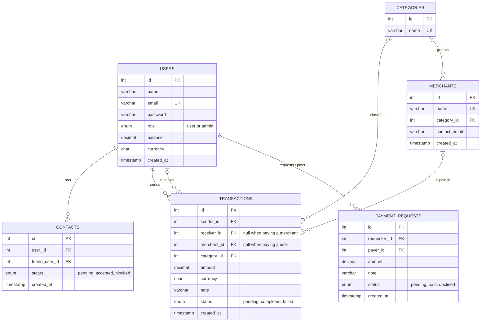

# Nummo — Entity Relationship Diagram

The same model is in [`erd.dbml`](erd.dbml) (open it on dbdiagram.io).

## Relationships

| Relationship | Type | Meaning |
|---|---|---|
| users → contacts | 1 : N (twice) | A contact row links a user (`user_id`) to another user (`friend_user_id`). |
| users → transactions | 1 : N | Every transaction has a sender. The receiver is a user **or** a merchant. |
| merchants → transactions | 1 : N | A payment to a shop sets `merchant_id` instead of `receiver_id`. |
| categories → transactions | 1 : N | Optional spending category of a payment. |
| categories → merchants | 1 : N | Default category of a merchant. |
| users → payment_requests | 1 : N (twice) | `requester_id` asks `payer_id` to pay an amount. |
